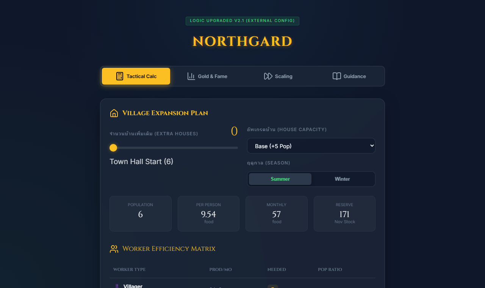

## Hi, I'm Kittin · Grit Craft

I build tools that take repetitive work off a logistics team in Thailand.
I start from the problem — what people do by hand every day — then build the smallest tool that removes it, with AI coding agents doing most of the typing and automated tests checking their work.

สร้างเครื่องมือลดงานซ้ำให้ทีมขนส่ง — เริ่มจากปัญหาที่คนทำมือทุกวัน แล้วทำเครื่องมือที่เล็กที่สุดที่แก้ได้

---

### 2,800+ contributions in the past year

Most of my work lives in private repositories because it runs on real company and customer data.
What those tools do:

- **Billing check** — compares delivery records with chat evidence from drivers and carriers, and flags trips charged wrong before the invoice goes out.
- **Dispatch desk** — plans delivery rounds and routes, and shows the day's jobs on one screen for the team.
- **Morning automation** — sorts the inbox, prepares daily reports and drafts replies for a person to review and send.
- **Guard rails for AI-written code** — pre-commit checks, tests and review steps that every change must pass before it is merged.

---

### Public projects

**[Zerg Initiative Playbook](https://kittinhulk.github.io/zerg-initiative-playbook/)** — StarCraft II decision guide in Thai &nbsp;·&nbsp; **[Northgard Tool](https://kittinhulk.github.io/northgard-tool/)** — house and food calculator

Also: [quant-dashboard](https://github.com/kittinhulk/quant-dashboard) — Streamlit dashboards for currency forecasting (Python)

---

### Latest videos — [Grit Craft](https://www.youtube.com/@GritCraftStudio)

<!-- BLOG-POST-LIST:START -->
- [EA Development Case Study | บันทึกการพัฒนาระบบเทรด XAUUSD](https://www.youtube.com/watch?v=YHZJFilpGBs) · May 2026
- [อัปเดต n8n ไม่ต้องกลัวข้อมูลหาย! สอนใช้ Docker Compose จัดการ Config และข้อมูลอย่างปลอดภัย](https://www.youtube.com/watch?v=2aghqmJ-72Q) · May 2025
- [Use case Runway gen3 : Forest magic](https://www.youtube.com/watch?v=17gdwdi_60o) · Oct 2024
- [สร้างวิดีโอ fashion จาก ตัวนายแบบ (MJ+Runway gen3)](https://www.youtube.com/watch?v=GmSd7BPcnmE) · Sep 2024
- [Comfyui mimicmotionliveportrait Use case  by Grit Ai Art](https://www.youtube.com/shorts/3hqRgtAW9xU) · Jul 2024
<!-- BLOG-POST-LIST:END -->

---

### Tools I use

**Code** &nbsp; Python · JavaScript · HTML/CSS · MQL5 · Claude Code 
**Automation** &nbsp; n8n · Power Automate · Power BI · LINE Messaging API · Raspberry Pi

---

### Contact

[LinkedIn](https://www.linkedin.com/in/kittin-k-8529ab112/) · [YouTube — Grit Craft](https://www.youtube.com/@GritCraftStudio) (Thai tech videos) · Thai or English
