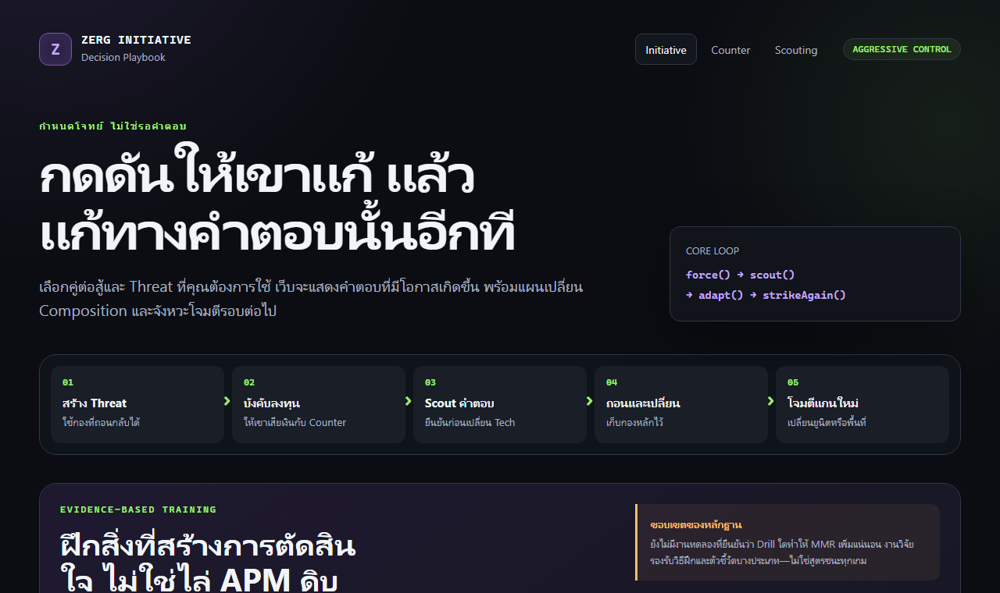

## Hi, I'm Kittin · Grit Craft

I build tools that take repetitive work off a logistics team in Thailand.
I start from the problem — what people do by hand every day — then build the smallest tool that removes it, with AI coding agents doing most of the typing and automated tests checking their work.

สร้างเครื่องมือลดงานซ้ำให้ทีมขนส่ง — เริ่มจากปัญหาที่คนทำมือทุกวัน แล้วทำเครื่องมือที่เล็กที่สุดที่แก้ได้

---

### 2,800+ contributions in the past year

Most of my work lives in private repositories because it runs on real company and customer data.
What those tools do:

- **Billing check** — compares delivery records with chat evidence from drivers and carriers, and flags trips charged wrong before the invoice goes out.
- **Dispatch desk** — plans delivery rounds and routes, and shows the day's jobs on one screen for the team.
- **Morning automation** — sorts the inbox, prepares daily reports and drafts replies for a person to review and send.
- **Guard rails for AI-written code** — pre-commit checks, tests and review steps that every change must pass before it is merged.

---

### Public projects

| Project | What it is |
|---|---|
| [Zerg Initiative Playbook](https://kittinhulk.github.io/zerg-initiative-playbook/) | Interactive StarCraft II guide in Thai: scouting, timings and how to respond |
| [Northgard Tool](https://kittinhulk.github.io/northgard-tool/) | Calculator for houses and food in the game Northgard |
| [quant-dashboard](https://github.com/kittinhulk/quant-dashboard) | Streamlit dashboards for currency forecasting (Python) |

---

### Tools I use

Python · JavaScript · HTML/CSS · n8n · Power Automate · Power BI · LINE Messaging API · Raspberry Pi · MetaTrader 5 (MQL5) · Claude Code

---

### Contact

[LinkedIn](https://www.linkedin.com/in/kittin-k-8529ab112/) · [YouTube — Grit Craft](https://www.youtube.com/@GritCraftStudio) (Thai tech videos) · Thai or English
